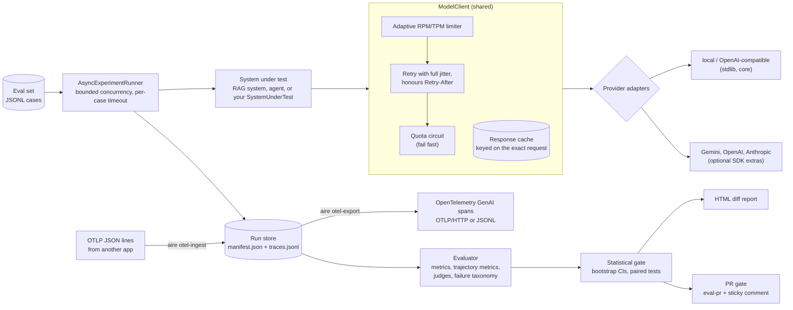
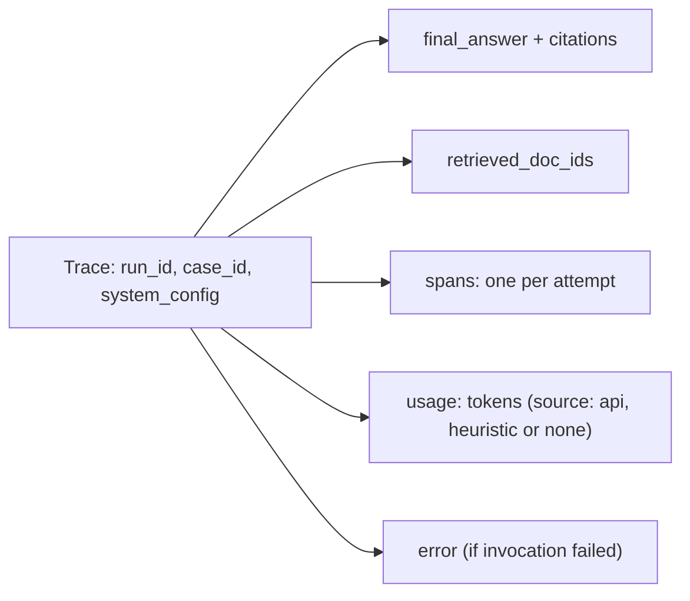
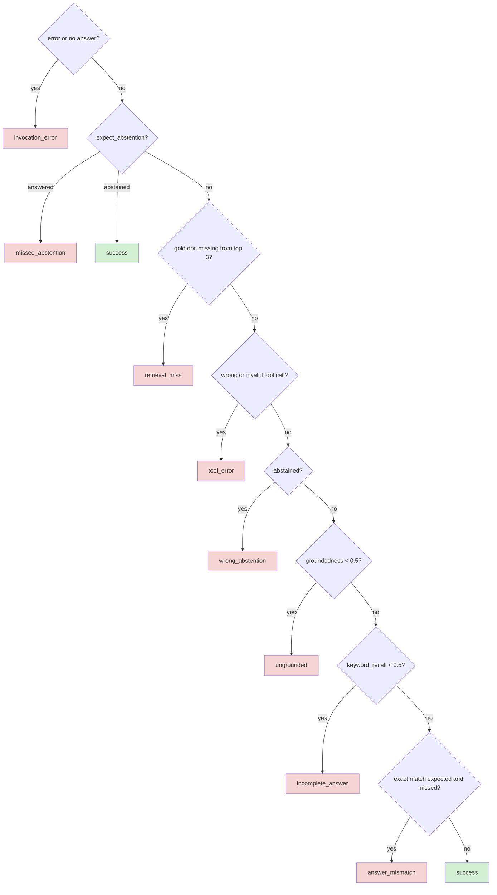

# AIRE: AI Reliability and Evaluation Engine

[](https://github.com/vaibhav3000/aire/actions/workflows/ci.yml)

AIRE is a trace-based evaluation framework for LLM, RAG and agent systems. It records what a system actually did (retrieved documents, tool calls, token usage, latencies), scores those records with deterministic metrics and calibrated judges, classifies failures into a fixed taxonomy, and gates a change against its baseline with paired statistical tests. The core has no runtime dependencies; provider SDKs and OpenTelemetry are optional extras.

## The problem

LLM-backed systems fail in ways that ordinary unit tests do not catch:

- A retrieval change can silently drop the document that contains the answer.
- A prompt or style change can make answers look fine while removing the citations that made them verifiable.
- An agent can reach the right answer through the wrong tools, or call a tool with arguments its schema forbids.
- Replacing a component can improve one metric while degrading another, and nobody notices until a user does.

Eyeballing outputs does not scale and is not reproducible, and a plain before/after mean cannot tell a real regression from noise on a suite of a hundred or so cases. Teams need recorded, replayable runs, a version-to-version comparison that says how sure it is, and a gate that runs on every pull request.

## How it works

AIRE separates three concerns that are usually tangled together:

1. **Record traces.** Every invocation of the system under test produces a validated `Trace`: spans with latencies, retrieved document ids, tool calls and token usage labelled by source. Each trace is appended to the run directory (`manifest.json` plus `traces.jsonl`) as soon as its case finishes, so an interrupted run keeps everything it completed, and traces are never modified afterwards.
2. **Evaluate recorded traces.** Metrics, judges and the failure taxonomy read traces; the system is never re-run to compute a score. New metrics can be applied to old runs, and the same trace set feeds per-case results, aggregates and reports.
3. **Compare runs.** The regression engine pairs two evaluated runs case by case. A change beyond the metric's tolerance counts as a regression or an improvement only when a paired test supports it (McNemar's exact test for 0/1 metrics, a seeded paired bootstrap otherwise); otherwise it is inconclusive. Holm-adjusted p-values are reported next to the raw ones. Every regression is attributed to the cases that moved.

## Architecture



The design and its alternatives are in [docs/design/step2.md](docs/design/step2.md). Decisions that are hard to reverse are recorded as ADRs:

- [ADR 0001](docs/adr/0001-model-client-owns-retries.md): the model client owns retries, rate limiting and the quota circuit, not the runner or the SDKs.
- [ADR 0002](docs/adr/0002-zero-dependency-core.md): a zero-dependency core with provider SDKs and OpenTelemetry as extras.
- [ADR 0003](docs/adr/0003-traces-canonical-otel-as-format.md): aire traces stay canonical; OpenTelemetry is an export and ingest format.
- [ADR 0004](docs/adr/0004-paired-tests-decide-the-gate.md): paired tests, not point deltas, decide the gate.
- [ADR 0005](docs/adr/0005-fork-safe-pr-comment.md): the PR comment is posted by a separate trusted workflow, so fork PRs never get a write token.
- [ADR 0006](docs/adr/0006-response-cache-keyed-on-exact-request.md): the response cache is keyed on the exact request.

Terms are defined in [docs/GLOSSARY.md](docs/GLOSSARY.md); the trace format is in [docs/trace_schema.md](docs/trace_schema.md); how the evaluation set was written is in [docs/eval_set.md](docs/eval_set.md); design questions and answers are in [docs/design_faq.md](docs/design_faq.md).

| Module | Responsibility |
| --- | --- |
| `src/aire/schema.py` | `Trace`, `Span`, `Usage`, token estimation, `validate_trace_dict` |
| `src/aire/runner/` | `EvalCase` dataset loading; `AsyncExperimentRunner` (async, cancels on timeout) and the sync `ExperimentRunner` |
| `src/aire/providers/` | `ModelClient` with limiter, retries, quota circuit and cache; adapters for local OpenAI-compatible endpoints (stdlib) and the Gemini, OpenAI and Anthropic SDKs; structured JSON output; `ScriptedChatModel` for tests |
| `src/aire/systems/` | `LLMRagSystem`, the real-LLM RAG system under test, and its prompts |
| `src/aire/llm/` | `SystemUnderTest` and `Judge` interfaces; the deterministic `KeywordRetriever` and `ExtractiveRAG` demo systems |
| `src/aire/evaluator/` | per-case metrics, retrieval and tool metrics, trajectory metrics, rubric and pairwise judges, judge calibration (Cohen's kappa), statistics, the engine and failure taxonomy |
| `src/aire/agents/` | ingestion of repo-engineer agent traces |
| `src/aire/regression/` | `compare_runs` with run-identity checks, paired tests and per-case attribution; the `aire-gate` CLI |
| `src/aire/telemetry/` | OpenTelemetry GenAI spans: OTLP JSON in the stdlib, the SDK bridge, export and ingest |
| `src/aire/report/` | the static HTML diff report and the markdown PR comment |
| `src/aire/ci/` | the sticky GitHub PR comment client |
| `src/aire/testing/` | `FakeLLMServer`, a rate-limited fake LLM endpoint on 127.0.0.1 for offline tests and benchmarks |
| `src/aire/cli.py` | the `aire` command |

## Installation

Python 3.11 or later. With [uv](https://docs.astral.sh/uv/), the locked environment (dev tools and every extra, exactly as CI installs it):

```bash
uv sync --locked --all-extras      # or: make setup
```

Run commands with `uv run --locked --all-extras ...`; a plain `uv run` re-syncs to the default extras and removes the dev tools. With pip instead:

```bash
python -m pip install -e ".[dev]"  # dev tools and every extra
python -m pip install .            # the core only: no third-party packages
python -m pip install "aire[gemini]"   # or openai, anthropic, otel, all
```

The core install runs the gate, the engine, the async runner and the local OpenAI-compatible adapter with no third-party package; CI checks that. No API key is needed for anything except a live LLM run: the committed demo results were produced offline. `.env.example` lists the optional keys (`.env` is gitignored and dockerignored).

The Makefile wraps the common tasks and works from Git Bash on Windows and from a Linux shell:

```bash
make check    # the full gate: lint, types, tests, demo drift, docs numbers, gates
make demo     # regenerate results/, reports/*.html and demo-site/data.js
make docs     # regenerate the numbers in this README, the FAQ and the report
make report   # build the technical report PDF (latexmk)
make docker   # build the gate image and gate v2 against v1 inside it
```

## The aire command

| Command | What it does |
| --- | --- |
| `aire gate BASE CAND [--ignore M] [--report gate.json]` | Compare two evaluated runs; exit 0 when nothing gated regressed, 1 on a regression, 2 on unusable input. Also installed as `aire-gate`. |
| `aire report BASE CAND --out report.html` | Render the HTML diff report: verdicts with evidence, confidence intervals and per-case attribution. |
| `aire markdown gate.json --out comment.md --title T` | Render a gate result as the sanitised PR comment. |
| `aire pr-comment ...` | Create or update the sticky PR comment (used by the trusted comment workflow). |
| `aire pr-check GATE_JSON --base-exit N --self-exit N` | Decide the PR evaluation check from the two gates' exit codes (used by `eval-pr.yml`). |
| `aire otel-export RUN (--jsonl F \| --endpoint URL)` | Export a run's traces as OpenTelemetry GenAI spans, as OTLP JSON lines or over OTLP/HTTP (the endpoint needs `aire[otel]`). Content is left out unless `--capture-content`. |
| `aire otel-ingest SPANS --dataset D --out RUN` | Turn OTLP JSON lines from another application into an aire run that the evaluator and the gate can use. |

`--threshold` sets the gate's tolerance: absolute for scores in [0, 1] (0.02 is two points), relative for latency, tokens and cost. `--method`, `--alpha` and `--fail-on-inconclusive` control the paired tests. A typical CI call:

```bash
aire gate results/v1_baseline runs/<candidate_run_id> \
    --ignore latency_ms --override total_tokens=0.1 --report gate.json
```

## Reproducing every result

Every committed number comes from one of these commands, and every number quoted in this README, the design FAQ and the technical report is rendered from the committed result files by `scripts/sync_docs.py` (a test fails when they disagree).

| Result | Command | Writes |
| --- | --- | --- |
| Deterministic v1, v2, v3, their comparisons, the retrieval ablation, the agent suite and the HTML reports | `python demo/run_demo.py` | `results/`, `reports/*.html` |
| Judge calibration with the offline lexical judge | `python demo/judge_calibration/calibrate_judges.py` | `results/judge_calibration.json` |
| Async runner benchmark against the local fake server | `python demo/bench_runner.py` | `results/runner_benchmark.json` |
| Demo site data | `python demo-site/build.py` | `demo-site/data.js` |
| Numbers in the docs | `python scripts/sync_docs.py` | README, FAQ, report |
| Technical report | `make report` | `reports/*.pdf` |
| Live LLM run (needs a key; costs quota) | `python scripts/run_llm_eval.py --provider gemini --model gemini-2.5-flash --rpm 10 --concurrency 4` | `results/llm_<model>/` |

The deterministic results are exact: rerunning the demo on an unchanged tree leaves git clean, and CI fails if it does not. Benchmark timings depend on the machine and are not compared. For the live run, `--dry-run` prints the number of calls and an upper bound on tokens without a key or network, and `--rescore` re-scores a persisted run with the current metric code without calling the model.

## The three-version demo

<!-- aire:begin readme-demo-intro -->
`demo/run_demo.py` runs three versions of a small RAG system over `demo/eval_set.jsonl` (150 cases: 130 answerable questions, 16 of them needing two documents, and 20 unanswerable questions; how they were written is in [docs/eval_set.md](docs/eval_set.md)) and `demo/corpus/` (12 product documentation files):
<!-- aire:end readme-demo-intro -->

- `v1_baseline`: overlap-weighted retrieval, top-1 document, faithful quoting with citations.
- `v2_improved`: idf-weighted retrieval, top-3 documents.
- `v3_fluent_regression`: same retrieval as v2, but the `fluent` style merges the quoted sentences into one and drops the citations. This is a deliberate regression planted to show what the evaluator catches.

Aggregates from the committed runs (`results/`). Every mean in `eval_results.json` also carries a seeded 95% bootstrap interval (`ci95_<metric>`):

<!-- aire:begin readme-aggregates -->
| Metric | v1 baseline | v2 improved | v3 fluent |
| --- | --- | --- | --- |
| retrieval_recall_at_1 | 0.7154 | 0.7154 | 0.7154 |
| retrieval_recall_at_3 | 0.7154 | 0.8615 | 0.8615 |
| retrieval_mrr_at_3 | 0.7769 | 0.8231 | 0.8231 |
| keyword_recall | 0.5503 | 0.5374 | 0.5374 |
| gold_citation_recall | 0.7154 | 0.7154 | 0.0000 |
| citation_precision | 1.0000 | 1.0000 | not measurable (no citations) |
| groundedness | 1.0000 | 1.0000 | 0.0000 |
| abstention_correct (20 unanswerable cases) | 0.0 | 0.1 | 0.1 |
| success_rate | 0.4267 | 0.4667 | 0.0133 |
<!-- aire:end readme-aggregates -->

<!-- aire:begin readme-ablation -->
Recall@3 rises from v1 to v2 because v2 retrieves three documents and v1 only one; recall@1 is identical. The retrieval ablation in `results/retrieval_ablation.json` keeps K fixed and changes only the weighting: over the 130 answerable cases at top 3, overlap reaches recall@1 0.7154, recall@3 0.8731 and MRR@3 0.8295, idf reaches 0.7154, 0.8615 and 0.8231. On this corpus idf weighting does not beat plain overlap; the gain is K.
<!-- aire:end readme-ablation -->

Regression verdicts. Latency is reported but not counted, because the demo's sub-millisecond timings are noise.

<!-- aire:begin readme-verdicts -->
- **v2 vs v1: no regressions detected** (2 improved, 10 neutral, 2 inconclusive, 0 regressed). `retrieval_recall_at_3` rose from 0.7154 to 0.8615 and `retrieval_mrr_at_3` from 0.7769 to 0.8231, both significant in the paired bootstrap. `success_rate` rose from 0.4267 to 0.4667 and `abstention_correct` from 0.0 to 0.1, but neither change is significant (McNemar p = 0.07 and 0.5), so both are inconclusive rather than improvements.
- **v3 vs v1: regressions detected** (4 regressed, 3 improved, 6 neutral, 1 inconclusive). `groundedness` fell from 1.0 to 0.0 on all 130 answerable cases and `gold_citation_recall` from 0.7154 to 0.0 because the fluent style drops every citation, `citation_precision` disappeared because nothing is cited, and `success_rate` fell from 0.4267 to 0.0133. Retrieval improved exactly as in v2 and mean heuristic tokens dropped (80.86 to 71.24). Failure-count deltas: `ungrounded` +109, `retrieval_miss` -24, `incomplete_answer` -21, `missed_abstention` -2. The report surfaces the trade-off instead of a single pass/fail number.
<!-- aire:end readme-verdicts -->

### A finding the evaluator surfaced: abstention does not work

<!-- aire:begin readme-abstention -->
`abstention_correct` is 0.0 for v1 and 0.1 for v2 and v3: of the 20 unanswerable questions, v1 refuses none and v2 two. The measured reason: with idf weighting their top retrieval scores range from 0.0056 to 0.4596, while 84 of the 130 answerable questions score no higher than 0.4596, so any `min_score` that rejects every unanswerable query also rejects most answerable ones (overlap weighting is no better: 0.1429 to 0.6667, with 108 answerable questions at or below the top). Deciding answerability needs semantic matching, which a bag-of-words retriever cannot do. See `docs/design_faq.md`.
<!-- aire:end readme-abstention -->

## Agent trajectories

<!-- aire:begin readme-agent -->
`demo/agent/` holds 4 real tool-calling trajectories copied from the sibling repo-engineer project (written by its scripted planner, not a model) and one synthetic variant of each with a single planted defect. Trajectory metrics compare the calls with a reference tool sequence and validate every argument against the tool's JSON Schema. Gating the variants against the originals gives "regressions detected": `tool_selection_accuracy` 1.0000 to 0.9500, `tool_call_precision` 0.8854 to 0.8414, `tool_args_schema_valid` 1.0000 to 0.9271 and `success_rate` 1.0000 to 0.5000. With four paired cases the gate applies the plain tolerance rule; a paired test needs at least ten.
<!-- aire:end readme-agent -->

## Judges and their calibration

<!-- aire:begin readme-calibration -->
`demo/judge_calibration/` holds 60 answers from the three demo versions with a yes/no label each for "correct" and "supported". The offline lexical rubric judge agrees with the labels on 95% of answers for correctness (Cohen's kappa 0.90) and 100% for support (kappa 1.00). **These kappas are provisional:** the labels have status `draft` and await the owner's review, so they measure agreement with unreviewed labels. The model judges (rubric, and pairwise with position swapping) are implemented and tested offline but have not been calibrated against a live model yet.
<!-- aire:end readme-calibration -->

## Async runner under rate limits

<!-- aire:begin readme-bench -->
Measured against `FakeLLMServer`, a rate-limited fake LLM endpoint on 127.0.0.1, not a real provider: 3000 requests per minute, 0.1 s per request and a retry hint on every 429. One run of each configuration over the 150-case suite, recorded at 2026-11-19T15:51Z in [results/runner_benchmark.json](results/runner_benchmark.json):

| Configuration | Wall time (s) | Requests sent | 429 responses | Failed cases |
| --- | --- | --- | --- | --- |
| 1 worker | 16.195 | 150 | 0 | 0 |
| 8 workers | 3.007 | 151 | 1 | 0 |
| 8 workers, client told twice the server's limit | 2.955 | 168 | 18 | 0 |
| 8 workers, warm response cache | 0.299 | 0 | 0 | 0 |

Eight workers finish 5.4 times faster than one. With its budget set too high, the client met 18 rate-limit responses, backed off as the server asked, and still answered every case. The warm cache answers the suite without a single request. The timings are from one machine (Windows-11-10.0.26300-SP0, Python 3.13.7); `make check` does not compare them, and `python demo/bench_runner.py` records a fresh run.
<!-- aire:end readme-bench -->

## Real-LLM mode

`scripts/run_llm_eval.py --provider {gemini,openai,anthropic,local} --model MODEL` runs the suite with local idf retrieval and real LLM generation through the async runner and the shared model client. It persists the run (`results/llm_<model>/` with manifest and traces), scores it with the same engine and compares it against the committed `results/v2_improved`.

### Live run in progress

<!-- aire:begin readme-live-run -->
A run of the current script was started on 2026-11-19 with gemini-2.5-flash on the free tier, through the google-genai adapter. State: **in progress**, 20 of 150 cases answered, using 12,369 prompt and 3,174 completion tokens by the API's count (2,397 of them reasoning). On the free tier the daily quota can stop a run partway; a rerun reuses the cached answers and sends only the missing cases. The traces, the manifest and an account of each stop are in [results/llm_gemini-2.5-flash/](results/llm_gemini-2.5-flash/NOTE.md). While the run is partial its answered cases are the first ones in dataset order, not a sample of the suite. No comparison with the deterministic systems is committed from this run yet: the top-level `results/llm_*.json` files still hold the historical run described below.
<!-- aire:end readme-live-run -->

### The historical run

<!-- aire:begin readme-llm-history-intro -->
**The committed LLM numbers are historical and not replayable.** They come from the original 26-case suite. `results/llm_eval_results.json`, `results/llm_vs_deterministic.json` and `reports/llm_vs_deterministic_v2.html` come from a single run committed on 2026-09-17, before the fixes in this repository. That run's traces were not kept, so it cannot be re-scored, and its numbers must not be read next to the regenerated deterministic ones. What it recorded, and what is now known about it:
<!-- aire:end readme-llm-history-intro -->

<!-- aire:begin readme-llm-history -->
- 17 of 26 cases succeeded; 6 calls failed with HTTP 429 quota errors and 1 answerable case was refused.
- It reported `abstention_correct` 1.0 against v2's 0.0: the model answered "I don't know." on all four unanswerable cases. That rests on four cases.
- Its `groundedness` of 1.0 averaged only the 15 cases that produced a claim (the failed and refused cases were dropped), against v2's 0.5682 over 22, and v2's figure came from the citation-placement bug fixed here (v2 now scores 1.0). There was no measured grounding gain.
- Its mean latency of 15.3 s per case included the client's own 5 s pacing and the retry sleeps on 429 responses, which now stay out of the timer.
- Its token mean (605 per case) mixed API counts with character estimates for the failed calls, and the comparison set it against a character estimate of question and answer for the extractive system (83), which makes no LLM call. The two are not comparable, and the gate no longer issues a token verdict across different token sources.
<!-- aire:end readme-llm-history -->

## Trace model and failure taxonomy

Every invocation is one validated trace (answer, retrieved docs, spans, token usage, error); evaluation reads traces, never re-runs the system.



The taxonomy assigns one category per failed case. The checks run in pipeline order, so a failure is blamed on the earliest stage that went wrong: a case whose gold document was never retrieved is a retrieval miss, not an incomplete answer.



A failed invocation scores 0 on every answer-quality metric and is never counted as a correct abstention, and every mean in the aggregates is reported with `n_<metric>`, the number of cases it averages.

## Pull request gate

`.github/workflows/eval-pr.yml` evaluates a pull request's code with a read-only token and no secrets, gates it against the base branch's committed results, and uploads the gate result and the HTML report as an artifact. `.github/workflows/eval-pr-comment.yml` runs on `workflow_run` in the trusted base-branch context, checks that the artifact belongs to the pull request's current head commit, renders a sanitised markdown summary and creates or updates one sticky comment. Fork pull requests therefore never run with a write token (ADR 0005).

A pull request that changes the evaluation set cannot be paired with the base branch's results, so the gate against the base branch refuses (exit 2) and writes a "not comparable" report naming the dataset file and both hashes. `aire pr-check` turns that one case into a warning annotation, and the comment says "Not comparable: this PR changes the evaluation set". The PR's fresh run is always also gated against the results committed in the PR (the snapshot taken before the demo reruns), so a regression in the same PR still fails the check. Every other exit 2, such as a crash or a missing or malformed run, fails it as before. The comment workflow renders with the default branch's aire, so the new comment wording appears once this change is on the default branch. Both workflows are tested offline (`tests/test_pr_comment.py`) but **have not run on GitHub yet**.

`.github/workflows/ci.yml` installs from `uv.lock`, runs ruff, pyright and the tests on Python 3.11, 3.13 and 3.14 on Linux and 3.13 on Windows, checks that the core imports with no third-party package, regenerates the demo and gates it (v2 must pass, v3 must be blocked for groundedness and gold citation recall), and fails if any regenerated artifact or quoted number differs from the commit.

## Project structure

```
aire/
    pyproject.toml, uv.lock   zero runtime dependencies; extras for SDKs, otel, dev
    Makefile                  setup, check, demo, docs, report, docker
    src/aire/                 the package (see the module table above)
    demo/
        run_demo.py           three-version demo, retrieval ablation, agent suite
        eval_set.jsonl        evaluation cases; validate_eval_set.py checks them
        corpus/               product documentation for a fictional cloud provider
        agent/                repo-engineer trajectories, schemas, synthetic variants
        judge_calibration/    calibration items, draft labels, calibrate_judges.py
        bench_runner.py       async runner benchmark against FakeLLMServer
    scripts/
        run_llm_eval.py       live LLM run, --dry-run and --rescore
        sync_docs.py          renders the numbers in the docs from results/
    results/                  committed evaluated runs, comparisons and benchmarks
    reports/                  HTML reports and the technical report
    demo-site/                static explorer of the committed results, with Playwright tests
    docs/
        design/step2.md       design of the async runner, adapters, statistics and telemetry
        adr/                  architecture decision records
        templates/            the text of every generated region
        GLOSSARY.md, design_faq.md, eval_set.md, trace_schema.md
    tests/                    pytest suite
```

## Technical report

An IEEE-style paper on the system is at [reports/AIRE_AI_Reliability_Evaluation_Engine.pdf](reports/AIRE_AI_Reliability_Evaluation_Engine.pdf), with its LaTeX source next to it (`make report`).

## Limitations

Stated plainly, because an evaluation tool that oversells itself is worthless:

- **No comparable LLM result is committed yet.** The live run's state is in Live run in progress above; the free-tier quota limits how many cases it answers per day, and the committed historical LLM numbers predate the fixes in this repository.
<!-- aire:begin readme-limit-judge -->
- **Judge agreement is provisional.** The kappas above are measured against 60 draft labels written by the author and not yet reviewed, and only the offline lexical judge has been calibrated.
<!-- aire:end readme-limit-judge -->
- **The throughput numbers come from a fake server.** The runner benchmark and the rate-limit tests run against `FakeLLMServer` on 127.0.0.1. They show that the limiter, retries and cache behave as designed under a server that enforces a limit; they say nothing about a real provider's latency or limits.
- **The PR workflows have never run on GitHub.** Their logic is tested offline, but the permissions, the artifact handoff and the comment have not been exercised in a real repository.
- **Lexical groundedness is a proxy, not entailment.** A claim counts as supported when at least half of its content keywords appear in a document it cites that the system actually retrieved (`EngineConfig.groundedness_min_overlap`). It is cheap, deterministic and auditable, but paraphrases that share vocabulary can fool it, it passes a sentence that is half fabricated at the default threshold, and it may undercount legitimate rewordings. It measures citation hygiene, not semantic faithfulness.
<!-- aire:begin readme-limit-stats -->
- **The gate's statistics cover case sampling, not model noise.** Intervals and paired tests treat the 150 cases as a sample of possible questions; they say nothing about how much a nondeterministic model's answers move between runs, which needs repeated runs. Below ten paired cases the gate falls back to the plain tolerance rule, and the demo's settings were fixed before the expanded suite existed, but the suite has no separate development split.
<!-- aire:end readme-limit-stats -->
- **The demo system under test is not an LLM.** `ExtractiveRAG` is a deterministic stand-in so that every committed number is exactly reproducible without network access or keys. Runs of systems that declare `deterministic = False` are marked as such in their manifest.
- **Token counts are heuristic in the demo.** Without a real API response, usage is estimated at roughly 4 characters per token and labelled `token_source: "heuristic"`. Failed calls get `token_source: "none"` and are left out of token means, and the gate gives no token verdict across different sources.
- **Abstention is an open gap in the demo.** Keyword-overlap scoring cannot separate answerable from unanswerable queries (see above). Recognition is deliberately exact-phrase: `metrics.ABSTENTION_PHRASES` is the single source of truth, so a third-party system that refuses with different wording is classified as answering.
- **Retrieval ground truth is hand-declared.** Each case lists `supporting_doc_ids` by hand. Building reliable retrieval ground truth at scale is a separate problem that this project does not pretend to solve.
- **The sync runner's timeout leaks a thread.** `ExperimentRunner` enforces timeouts with a watchdog thread, which cannot kill a hung call. The async runner cancels the call instead, which closes its connection.
- **Latency in the demo is not LLM latency.** Sub-millisecond extractive answering says nothing about production latency; latency is reported but not gated for the demo.

## Docker

The image is a small runtime image for the gate (pinned base, non-root user, no dev tools). Mount evaluated run directories and compare them:

```bash
docker build -t aire .
docker run --rm -v "$PWD/results:/data:ro" aire /data/v1_baseline /data/v2_improved --ignore latency_ms
```
