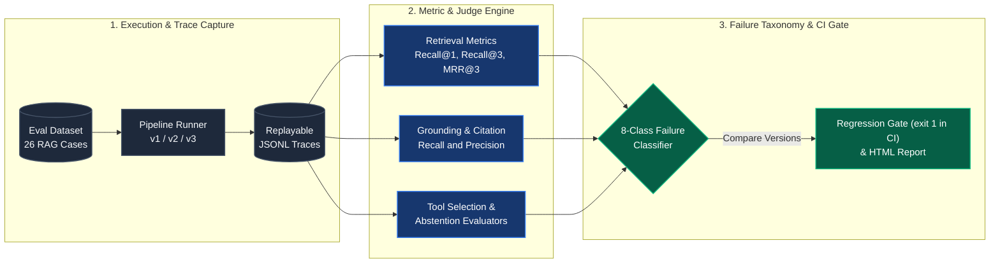
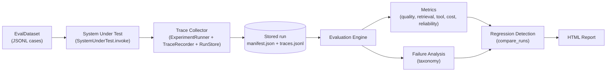
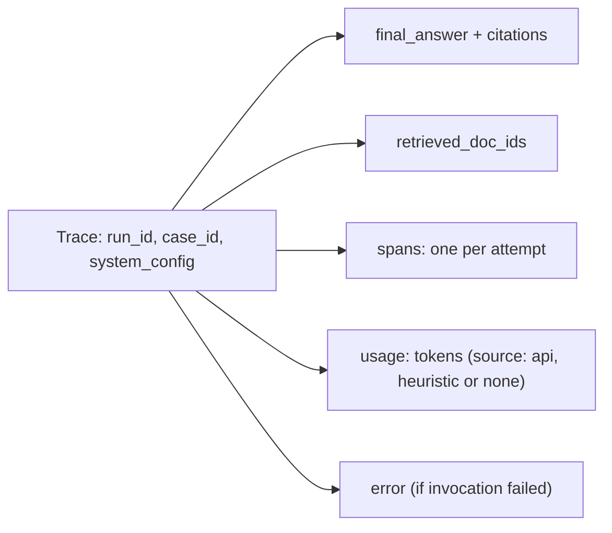
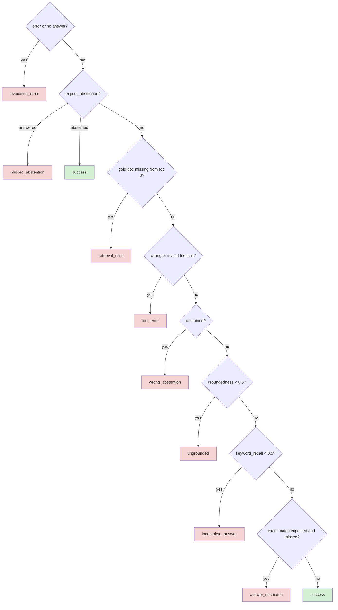

# AIRE: AI Reliability and Evaluation Engine

[](https://github.com/vaibhav3000/aire/actions/workflows/ci.yml)

AIRE is a trace-based evaluation framework for LLM, RAG, and agent systems. It records what a system actually did (retrieved documents, tool calls, token usage, latencies), scores those records with deterministic metrics and pluggable judges, classifies failures into a fixed taxonomy, and compares runs to detect regressions between system versions.

## The problem

LLM-backed systems fail in ways that ordinary unit tests do not catch:

- A retrieval change can silently drop the document that contains the answer.
- A prompt or style change can make answers look fine while removing the citations that made them verifiable.
- Replacing a component can improve one metric while degrading another, and nobody notices until a user does.

Scoring answers inside the application, or eyeballing outputs in a chat window, does not scale and is not reproducible. Teams need a recorded, comparable, version-to-version view of system behavior.

## The key idea

AIRE separates three concerns that are usually tangled together:

1. **Record traces.** Every invocation of the system under test produces a validated `Trace`: one span per attempt with its latency, retrieved document ids, tool calls, and token usage. Each trace is appended to the run directory (`manifest.json` plus `traces.jsonl`) as soon as its case finishes, so an interrupted run keeps everything it completed, and traces are never modified afterwards.
2. **Evaluate recorded traces.** Metrics, judges, and the failure taxonomy read traces. The system is never re-run to compute a score. Evaluation is therefore replayable: new metrics can be applied to old runs, and the same trace set feeds per-case results, aggregates, and reports.
3. **Compare runs.** The regression engine compares two evaluated runs over the same dataset metric by metric, using the direction from a metric registry (higher-better vs lower-better), an absolute tolerance for scores in [0, 1] and a relative one for latency and tokens, and per-case attribution for every regression. A metric that the baseline reports but the candidate does not counts as a regression.

## Architecture



Module map:

| Module | Responsibility |
| --- | --- |
| `src/aire/schema.py` | `Trace`, `Span`, `Usage` dataclasses, token estimation, `validate_trace_dict` |
| `src/aire/llm/base.py` | `SystemUnderTest` and `Judge` interfaces, `SUTResult` |
| `src/aire/llm/deterministic.py` | `KeywordRetriever` (overlap and idf weighting) and the `ExtractiveRAG` demo system |
| `src/aire/llm/provider.py`, `openai_compat.py` | Stdlib OpenAI-compatible client with a classified retry policy, and the real-LLM system under test |
| `src/aire/runner/` | Strict `EvalCase` dataset loading; `ExperimentRunner` with timeout, retry and untimed pacing |
| `src/aire/tracing/` | `TraceRecorder` for fine-grained spans; `RunStore` for crash-safe run directories |
| `src/aire/evaluator/` | `metrics.py`, `retrieval_metrics.py`, `tool_metrics.py`, `judges.py`, `engine.py` |
| `src/aire/regression/` | `compare_runs` with run-identity checks and per-case attribution; the `aire-gate` CLI |
| `src/aire/report/html.py` | Static, dependency-free, escaped HTML reports |

The engine computes 17 per-case metrics (recall is reported at two cut-offs by default) plus a run-level `success_rate`. The demo exercises all of them except `exact_match` and the three tool metrics, because its eval set has no exact-answer or tool cases, and `cost_usd` is always 0 there because the demo prices tokens at 0 USD.

## The three-version demo

`demo/run_demo.py` runs three versions of a small RAG system over `demo/eval_set.jsonl` (26 cases: 22 answerable questions, two of them needing two documents, and 4 unanswerable questions) and `demo/corpus/` (12 product documentation files):

- `v1_baseline`: overlap-weighted retrieval, top-1 document, faithful quoting with citations.
- `v2_improved`: idf-weighted retrieval, top-3 documents.
- `v3_fluent_regression`: same retrieval as v2, but the `fluent` style merges the quoted sentences into one and drops the citations. This is a deliberate regression planted to show what the evaluator catches.

Aggregate results from the committed run (`results/`, generated by `python demo/run_demo.py`):

| Metric | v1 baseline | v2 improved | v3 fluent |
| --- | --- | --- | --- |
| retrieval_recall_at_1 | 0.7273 | 0.7273 | 0.7273 |
| retrieval_recall_at_3 | 0.7273 | 0.9091 | 0.9091 |
| retrieval_mrr_at_3 | 0.7727 | 0.8333 | 0.8333 |
| keyword_recall | 0.5758 | 0.5758 | 0.5758 |
| gold_citation_recall | 0.7273 | 0.7273 | 0.0000 |
| citation_precision | 1.0000 | 1.0000 | not measurable (no citations) |
| groundedness | 1.0000 | 1.0000 | 0.0000 |
| abstention_correct (4 unanswerable cases) | 0.0 | 0.0 | 0.0 |
| success_rate | 0.4615 | 0.5000 | 0.0000 |

Recall@3 rises from v1 to v2 because v2 retrieves three documents and v1 only one; recall@1 is identical. The retrieval ablation in `results/retrieval_ablation.json` keeps K fixed and changes only the weighting: over the 22 answerable cases at top 3, overlap reaches recall@1 0.7273, recall@3 0.9545 and MRR@3 0.8485, idf reaches 0.7273, 0.9091 and 0.8333. On this corpus idf weighting does not beat plain overlap; the gain is K.

Regression verdicts (latency is reported but not counted: the demo's sub-millisecond timings are noise, and counting them made the summary flip between runs):

- **v2 vs v1: no regressions detected** (3 improved, 11 neutral, 0 regressed). `retrieval_recall_at_3` rose from 0.7273 to 0.9091, `retrieval_mrr_at_3` from 0.7727 to 0.8333 and `success_rate` from 0.4615 to 0.5; everything else held.
- **v3 vs v1: regressions detected** (4 regressed, 3 improved, 7 neutral). `groundedness` fell from 1.0 to 0.0 and `gold_citation_recall` from 0.7273 to 0.0 because the fluent style drops every citation, `citation_precision` disappeared because nothing is cited, and `success_rate` fell from 0.4615 to 0.0. Retrieval improved exactly as in v2 and mean heuristic tokens dropped (79.5 to 70.7). Failure-count deltas: `ungrounded` +20, `retrieval_miss` -5, `incomplete_answer` -3. The report surfaces the trade-off instead of a single pass/fail number.

### A finding the evaluator surfaced: abstention does not work

`abstention_correct` is 0.0 for every demo version: the four unanswerable questions are never refused. The measured reason: with idf weighting their top retrieval scores range from 0.18 to 0.46, while answerable questions go as low as 0.19, so any `min_score` that rejects every unanswerable query also rejects answerable ones (overlap weighting is no better: 0.17 to 0.67 against 0.20). Deciding answerability needs semantic matching, which a bag-of-words retriever cannot do. See `docs/design_faq.md`.

## Real-LLM mode (recorded separately)

`python scripts/run_llm_eval.py` runs the same 26-case suite with an `OpenAIChatResponder`: local idf retrieval and real LLM generation (gemini-2.5-flash via its OpenAI-compatible endpoint, temperature 0, API key from the environment). The script persists the run (`results/llm_<model>/` with manifest and traces), scores it with the same engine and compares it against the committed `results/v2_improved`. `python scripts/run_llm_eval.py --rescore` re-scores a persisted run with the current metric code without calling the model.

**The committed LLM numbers are historical and not replayable.** `results/llm_eval_results.json`, `results/llm_vs_deterministic.json` and `reports/llm_vs_deterministic_v2.html` come from a single run committed on 2026-09-17, before the fixes in this repository. That run's traces were not kept, so it cannot be re-scored, and its numbers must not be read next to the regenerated deterministic ones. What it recorded, and what is now known about it:

- 17 of 26 cases succeeded; 6 calls failed with HTTP 429 quota errors and 1 answerable case was refused.
- It reported `abstention_correct` 1.0 against v2's 0.0: the model answered "I don't know." on all four unanswerable cases. That rests on four cases.
- Its `groundedness` of 1.0 averaged only the 15 cases that produced a claim (the failed and refused cases were dropped), against v2's 0.5682 over 22, and v2's figure came from the citation-placement bug fixed here (v2 now scores 1.0). There was no measured grounding gain.
- Its mean latency of 15.3 s per case included the client's own 5 s pacing and the retry sleeps on 429 responses, which now stay out of the timer.
- Its token mean (605 per case) mixed API counts with character estimates for the failed calls, and the comparison set it against a character estimate of question and answer for the extractive system (83), which makes no LLM call. The two are not comparable, and the gate no longer issues a token verdict across different token sources.

Comparable LLM numbers need a new run with the current script.

## Trace model and failure taxonomy

Every invocation is one validated trace (answer, retrieved docs, spans, token usage, error); evaluation reads traces, never re-runs the system.



The taxonomy assigns one category per failed case. The checks run in pipeline order, so a failure is blamed on the earliest stage that went wrong: a case whose gold document was never retrieved is a retrieval miss, not an incomplete answer.



A failed invocation scores 0 on every answer-quality metric and is never counted as a correct abstention, and every mean in the aggregates is reported with `n_<metric>`, the number of cases it averages.

## Installation

Requires Python >= 3.11. AIRE has zero runtime dependencies; the dev extra pins `pytest`, `ruff` and `pyright`.

```bash
cd aire
pip install -e ".[dev]"
```

The demo, the LLM script and the tests import the installed package, so install it before running them. No API keys are needed: the committed demo results were produced entirely offline by the deterministic responder in `src/aire/llm/deterministic.py`. See `.env.example` for the optional keys used with a real LLM adapter (`.env` is gitignored and dockerignored).

## Usage

Run the three-version demo end to end:

```bash
python demo/run_demo.py
```

Outputs:

- `runs/<run_id>/` for each version: `manifest.json`, `traces.jsonl`, `eval_results.json` (gitignored)
- `results/<version>/`: the committed copies, replaced only when something other than timing changed, so rerunning the demo on an unchanged tree leaves git clean
- `results/v2_improved_vs_v1_baseline.json`, `results/v3_fluent_regression_vs_v1_baseline.json` and the matching `reports/*.html` dashboards
- `results/retrieval_ablation.json`

Gate a change in CI. `aire-gate` (also `python -m aire.regression.gate`) compares two evaluated runs and exits 0 when no gated metric regressed, 1 when one did, and 2 when the inputs are unusable (a missing or malformed run, or two runs over different datasets), printing per-case attribution for every regression:

```bash
aire-gate results/v1_baseline runs/<candidate_run_id> \
    --threshold 0.02 --override latency_ms=0.5 --ignore cost_usd --report gate.json
```

`--threshold` is an absolute tolerance for scores in [0, 1] (0.02 is two points) and a relative one for latency, tokens and cost.

This repository gates itself. The `eval-gate` job in `.github/workflows/ci.yml` regenerates the demo, gates the fresh v2 against the committed v2, requires v2 to pass against v1, requires the gate to block v3 and checks from the JSON report that it was blocked for groundedness and gold citation recall, then fails if any regenerated artifact differs from the commit. A separate job runs `ruff check`, `ruff format --check` and `pyright`, and the tests run on Python 3.11, 3.13 and 3.14 on Linux and 3.13 on Windows.

Run the tests and validate the evaluation set:

```bash
python -m pytest -q
python demo/validate_eval_set.py
```

## Project structure

```
aire/
    pyproject.toml            zero runtime dependencies, Python >= 3.11
    src/aire/
        schema.py             Trace, Span, Usage, validate_trace_dict
        llm/
            base.py           SystemUnderTest, Judge, SUTResult
            deterministic.py  KeywordRetriever, ExtractiveRAG (demo stand-in)
            provider.py       OpenAI-compatible client and retry policy
            openai_compat.py  OpenAIChatResponder (real-LLM system under test)
        runner/
            dataset.py        EvalCase, strict JSONL dataset loading
            runner.py         ExperimentRunner: timeout, retry, spans, pacing
        tracing/
            recorder.py       TraceRecorder for multi-span instrumentation
            storage.py        RunStore, atomic writes, manifests
        evaluator/
            metrics.py        keyword, citation, groundedness and abstention
                              metrics, metric registry
            retrieval_metrics.py  recall@k, MRR@k
            tool_metrics.py   tool selection, argument validity and matching
            judges.py         GroundednessJudge, LLMJudge interface
            engine.py         EvaluationEngine, failure taxonomy, aggregates
        regression/
            compare.py        compare_runs, RegressionThresholds
            gate.py           aire-gate CLI: exit 1 on regression, for CI
        report/
            html.py           static HTML run and comparison reports
    demo/
        run_demo.py           three-version demo and retrieval ablation
        eval_set.jsonl        26 evaluation cases
        corpus/               12 Northwind Cloud documentation files
        validate_eval_set.py
    scripts/run_llm_eval.py   real-LLM run and --rescore
    tests/                    pytest suite
    runs/                     raw run directories (gitignored; results/ holds the curated copies)
    results/                  committed JSON results (tracked)
    reports/                  committed HTML reports and the technical report (tracked)
    demo-site/                static explorer of the committed results, with Playwright tests
    docs/
        design_faq.md         design Q&A for code reviews and design discussions
        trace_schema.md       trace JSON schema and run directory layout
```

## Technical Report

A concise IEEE-style technical paper documenting this system is available at
[reports/AIRE_AI_Reliability_Evaluation_Engine.pdf](reports/AIRE_AI_Reliability_Evaluation_Engine.pdf),
with its LaTeX source next to it (`latexmk -pdf` in `reports/`).

## Limitations

Stated plainly, because an evaluation tool that oversells itself is worthless:

- **Lexical groundedness is a proxy, not entailment.** A claim counts as supported when at least half of its content keywords appear in a document it cites that the system actually retrieved (the overlap threshold is `EngineConfig.groundedness_min_overlap`). It is cheap, deterministic, and auditable, but it can be fooled by paraphrases that share vocabulary with the source, it passes a sentence that is half fabricated at the default threshold, and it may undercount legitimate rewordings. It measures citation hygiene, not semantic faithfulness.
- **The gate is a change detector, not a statistical test.** The default tolerance (two points on a 0-1 score) is small next to the sampling noise of a mean over 22 cases: a single case whose score moves by 0.44 or more shifts the mean past it. For the deterministic demo that is the intent, since any change is real. For an LLM system at temperature 0, which is still nondeterministic, it will flap: there are no repeated runs, confidence intervals or paired tests, the thresholds were chosen on the same 26 cases they gate, and abstention rests on 4 cases. Gating a real model needs tolerances set above the run-to-run spread measured over several runs.
- **The demo system under test is not an LLM.** `ExtractiveRAG` is a deterministic stand-in so that every committed number is exactly reproducible without network access or keys. The `SystemUnderTest` interface is the integration point for real LLM applications; runs of systems that declare `deterministic = False` are marked as such in their manifest.
- **Token counts are heuristic in the demo.** Without a real API response, usage is estimated at roughly 4 characters per token of the question and answer and labelled `token_source: "heuristic"`. Failed calls get `token_source: "none"` and are left out of token means. Heuristic and API counts are not comparable, and the gate gives no token verdict across different sources.
- **Abstention is an open gap in the demo.** As described above, keyword-overlap scoring cannot separate answerable from unanswerable queries. Recognition is deliberately exact-phrase: `metrics.ABSTENTION_PHRASES` is the single source of truth (matching ignores case, curly apostrophes, trailing punctuation and citations), the demo SUT emits one of those phrases, and the real-LLM prompt mandates the same sentence. A third-party system that refuses with different wording is classified as answering.
- **Retrieval ground truth is hand-declared.** Each case lists `supporting_doc_ids` by hand. Building reliable retrieval ground truth at scale is a separate problem that this project does not pretend to solve.
- **Thread-based timeout leaks.** The runner enforces invocation timeouts with a watchdog thread; Python threads cannot be killed, so a hung call leaks its worker thread. The LLM script sets the runner timeout above the provider's worst-case call duration and totals tokens from the recorded traces, so a leaked call cannot inflate the results, but it can still use quota.
- **Latency in the demo is not LLM latency.** Sub-millisecond extractive answering says nothing about production latency; latency is reported but not gated for the demo.

## Docker Quickstart

The image is a small runtime image for the gate (pinned base, non-root user, no dev tools). Mount evaluated run directories and compare them:

```bash
docker build -t aire .
docker run --rm -v "$PWD/results:/data:ro" aire /data/v1_baseline /data/v2_improved --ignore latency_ms
```
